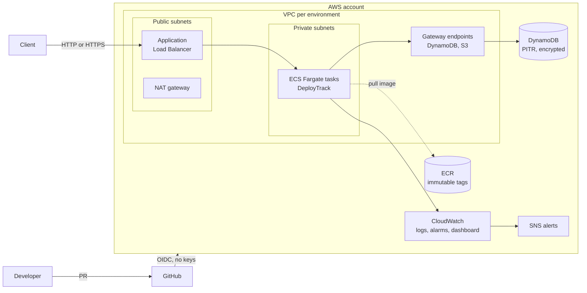
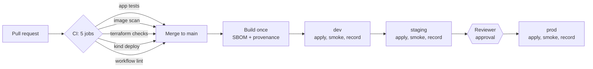

# AWS DevOps Delivery Platform

[](https://github.com/MyWorkPortfolio/aws-devops-delivery-platform/actions/workflows/ci.yml)

A production style delivery platform on AWS. It designs, builds and maintains cloud infrastructure for **development, staging and production environments**, and promotes one immutable container image through all three with automated checks and a human approval gate before prod.

The workload is **DeployTrack**, a small Python API that records every deployment and reports the four **DORA metrics**. The pipeline posts each of its own deployments to it, so the platform measures its own delivery performance.

---

## What this demonstrates

| Area | Implementation |
|---|---|
| **Infrastructure as Code** | Terraform with five reusable modules, thin per environment roots, S3 state with native locking |
| **Multi environment** | dev, staging and prod built from one module and differing only in sizing ([environments.md](docs/environments.md)) |
| **CI/CD** | GitHub Actions: lint, test, scan, validate on every PR; build once, promote dev → staging → prod |
| **Release safety** | ECS circuit breaker with auto rollback, `wait_for_steady_state`, version aware smoke tests, one click rollback |
| **Containers** | Multi stage, non root, read only Dockerfile; ECS Fargate; Helm chart deployed to a kind cluster in CI |
| **Kubernetes** | Helm chart with liveness, readiness and startup probes, HPA, PDB, topology spread, restricted security context |
| **Observability** | Prometheus metrics, JSON logs, CloudWatch alarms on golden signals, dashboards, Grafana locally |
| **Security** | OIDC (no stored keys), environment scoped IAM, least privilege task role, private subnets, checkov, Grype, SHA pinned actions |
| **Operations** | Runbooks for errors, latency and failed deploys; ADRs for every major decision |
| **Development** | Typed FastAPI service, 20 tests at 96% coverage, DynamoDB single table design tested against moto |

---

## Architecture



## Delivery pipeline



Each environment stage runs `terraform plan` and `terraform apply`, waits for ECS steady state, checks that the **new SHA** is serving, then records the outcome in DeployTrack. A failure at any stage stops promotion.

---

## Run it locally in two minutes

Requires Docker and Python 3.13.

```bash
make up      # app + DynamoDB local + Prometheus + Grafana
make seed    # 30 days of sample deployments
make smoke   # same smoke test the pipeline runs
```

| URL | What |
|---|---|
| http://localhost:8080/docs | Interactive API docs |
| http://localhost:8080/api/v1/dora?environment=prod | DORA report |
| http://localhost:9090/alerts | Prometheus alert rules |
| http://localhost:3000 | Grafana dashboard *DeployTrack overview* |

Kubernetes path: `make kind-up` creates a three node kind cluster and installs the Helm chart.

Example DORA response:
```json
{
  "environment": "prod",
  "window_days": 30,
  "deployments": 52,
  "deployment_frequency_per_day": 1.733,
  "lead_time_hours_median": 16.74,
  "change_failure_rate": 0.019,
  "mttr_hours": 5.37,
  "performance_tier": "high"
}
```

---

## Repository layout

```
app/                      FastAPI service, tests, Dockerfile
infra/
  bootstrap/              one time: state bucket, ECR, GitHub OIDC roles
  modules/
    network/              VPC, subnets over 2 or 3 AZs, NAT, gateway endpoints, flow logs
    dynamodb/             single table, PITR, encryption, deletion protection
    ecs_service/          cluster, ALB, task definition, service, autoscaling, IAM
    observability/        SNS, golden signal alarms, log metric filter, dashboard
    platform/             composes the four modules above for one environment
  envs/{dev,staging,prod} thin roots: sizing only
deploy/helm/deploytrack   Helm chart, plus values for kind
observability/            Prometheus rules and Grafana dashboard for the local stack
scripts/                  smoke test, deployment recorder, data seeder
docs/                     ADRs, runbooks, environment matrix
.github/workflows/        ci, deploy, reusable _deploy, rollback
```

---

## Deploying to your own AWS account

1. **Bootstrap** once with admin credentials:
   ```bash
   cd infra/bootstrap
   terraform init
   terraform apply -var github_repository=MyWorkPortfolio/aws-devops-delivery-platform
   ```
2. **Repository variables** (Settings → Secrets and variables → Actions → Variables):
   `AWS_REGION`, `TF_STATE_BUCKET`, and `AWS_BUILD_ROLE_ARN` from the bootstrap outputs. Optional: `ALARM_EMAIL`, `CERTIFICATE_ARN`.
3. **GitHub Environments** `dev`, `staging` and `prod`: on each, set the variable `AWS_DEPLOY_ROLE_ARN` to the matching role from `deploy_role_arns`. On `prod`, add **required reviewers**.
4. Set the repository variable `AWS_DEPLOY_ENABLED=true` and push to `main`.

No AWS keys are stored anywhere. See [ADR 0003](docs/adr/0003-github-oidc.md).

---

## Decisions

| ADR | Decision |
|---|---|
| [0001](docs/adr/0001-ecs-fargate-runtime.md) | ECS Fargate on AWS, Helm chart kept for Kubernetes |
| [0002](docs/adr/0002-build-once-promote.md) | Build once, promote one immutable image |
| [0003](docs/adr/0003-github-oidc.md) | GitHub OIDC with environment scoped roles |
| [0004](docs/adr/0004-terraform-layout.md) | One Terraform root per environment, one shared module |
| [0005](docs/adr/0005-dora-metrics.md) | The platform measures its own DORA metrics |
| [0006](docs/adr/0006-security-baseline.md) | Security baseline and accepted exceptions |

## Runbooks
[High error rate](docs/runbooks/high-error-rate.md) · [High latency](docs/runbooks/high-latency.md) · [Failed deployment and rollback](docs/runbooks/failed-deployment.md)

## Roadmap
- [ ] HTTPS by default with Route 53 and ACM
- [ ] WAF and ALB access logs in prod
- [ ] Terraform plan posted on pull requests with a read only role
- [ ] Canary releases with CodeDeploy blue/green
- [ ] EKS environment driven by the existing Helm chart

## License
MIT
